# Papers With Code database schema

Live structure, the ORM in `backend/models/database/`, and the migrations in
`backend/database/migrations/` were audited together on 2026-10-28.

## Authority and topology

The live database is authoritative for deployed structure. The SQLAlchemy
models describe the intended application schema, while the SQL migrations
contain both deployed and pending changes. Do not assume that all three are
identical; see [Known drift](#known-drift).

Production and staging share one PostgreSQL database:

- `public` contains the research catalog plus production-owned account,
  workflow, and chat state.
- `staging` contains staging-owned account, workflow, and chat state.
- Staging uses `search_path=staging,public`, so state tables shadow their
  production equivalents while catalog reads fall through to `public`.
- Production uses `search_path=public`.

At the audit point there were 139 tables in `public` (including the
partitioned `paper_embeddings` parent and its partition), 83 in `staging`, and
144 tables declared by the ORM. Counts include operational and transitional
tables, not views.

## Core entity relationships

The diagram intentionally shows relationships rather than every column. The
table inventory below covers the rest of the schema.

```mermaid
erDiagram
    AREAS ||--o{ TASKS : groups
    AREAS ||--o{ METHODS : groups
    TASKS ||--o{ TASKS : parent_of

    PAPERS ||--o{ PAPER_AUTHORS : has
    AUTHORS ||--o{ PAPER_AUTHORS : writes
    AUTHORS ||--o| AUTHOR_GOOGLE_SCHOLAR_PROFILES : links
    PAPERS ||--o{ PAPER_ABSTRACT_MENTIONS : mentions
    PAPERS ||--o{ PAPER_TASKS : addresses
    TASKS ||--o{ PAPER_TASKS : tags
    PAPERS ||--o{ PAPER_METHODS : uses
    METHODS ||--o{ PAPER_METHODS : tags
    PAPERS ||--o{ PAPER_DATASETS : uses
    DATASETS ||--o{ PAPER_DATASETS : tags

    TASKS ||--o{ TASK_DATASETS : exposes
    DATASETS ||--o{ TASK_DATASETS : benchmark_for
    TASKS ||--o{ TASK_DATASET_METRICS : scopes
    DATASETS ||--o{ TASK_DATASET_METRICS : benchmark_for
    METRICS ||--o{ TASK_DATASET_METRICS : measures
    PAPERS ||--o{ EVALUATIONS : reports
    TASKS ||--o{ EVALUATIONS : scopes
    DATASETS ||--o{ EVALUATIONS : evaluates_on

    PAPERS ||--o{ PAPER_REPOSITORIES : links
    REPOSITORIES ||--o{ PAPER_REPOSITORIES : implementation
    REPOSITORIES ||--o{ REPOSITORY_STAR_HISTORY : snapshots
    PAPERS ||--o{ PAPER_PROJECT_PAGES : links
    PROJECT_PAGES ||--o{ PAPER_PROJECT_PAGES : showcases
    PAPERS ||--o{ PAPER_X_THREADS : discussed_in

    PAPERS ||--o{ PAPER_HF_ARTIFACTS : links
    HF_ARTIFACTS ||--o{ PAPER_HF_ARTIFACTS : hosts
    PAPERS ||--o{ MODEL_RELEASES : introduces
    MODEL_RELEASES ||--o{ MODEL_RELEASE_ARTIFACTS : publishes
    HF_ARTIFACTS ||--o{ MODEL_RELEASE_ARTIFACTS : realizes
    MODEL_RELEASES ||--o{ MODEL_PROVIDER_ALIASES : aliases
    PAPERS ||--o{ MODEL_RELEASE_SIGNALS : resolves

    PAPERS ||--o{ PAPER_CONFERENCES : appears_at
    CONFERENCES ||--o{ PAPER_CONFERENCES : accepts
    CONFERENCES ||--o{ CONFERENCE_DEADLINES : schedules
    PAPERS ||--o{ PAPER_ORGANIZATIONS : affiliated_with
    ORGANIZATIONS ||--o{ PAPER_ORGANIZATIONS : publishes

    FRAMEWORK_DOMAINS ||--o{ FRAMEWORK_CATEGORIES : contains
    FRAMEWORK_CATEGORIES ||--o{ FRAMEWORKS : contains
    FRAMEWORKS ||--o{ FRAMEWORK_PLATFORMS : supports
    TASKS ||--o{ TASK_FRAMEWORKS : recommends
    FRAMEWORKS ||--o{ TASK_FRAMEWORKS : recommended_for
```

## Important invariants

- An arXiv paper version is identified by `(arxiv_id, version)`, enforced by a
  partial unique index when `arxiv_id` is present; use
  `papers.is_latest_version` when querying the current version. External papers
  use `source='external'`, may omit `arxiv_id`, and require `source_url`.
- Tasks form an arbitrary-depth tree through `tasks.parent_id`; `level` caches
  the depth. Evaluations and leaderboards belong to the most-specific task.
- `task_datasets` controls benchmark membership and display metadata.
  `task_dataset_metrics` defines valid `(task, dataset, metric)` leaderboards.
- `evaluations.metrics` is JSONB and `evaluations.best_metric` is a metric name,
  not a foreign key to `metrics`. The service layer validates the leaderboard
  triple.
- A `(dataset, best_metric)` leaderboard lives on exactly one task. The
  deferred `evaluations_single_benchmark_board` constraint trigger rejects a
  second task at commit time, except for pairs listed in
  `benchmark_task_board_exceptions`.
- `paper_abstract_mentions` stores judged method, dataset, and framework spans
  in a paper abstract as polymorphic `(entity_type, entity_id)` references,
  stamped with the abstract's SHA so stale spans can be detected.
- Paper lineage is directed: `paper_relations.source_paper_id` is the
  predecessor and `target_paper_id` is the successor. Self-edges are rejected.
- `paper_method_evidence` records why a method link exists;
  `paper_method_exclusions` records durable curator vetoes.
- `paper_repositories.is_official` is relationship-specific.
  `project_pages.is_official` is stored on the page row.
- Task, method, and conference hero images may be stored as deferred BYTEA data
  plus a MIME type. Dataset and paper images remain URL-backed. Organization
  logos have their own BYTEA, MIME type, and SHA-256 fields.
- User identity is the lower-cased Hugging Face username used by the session.
  Original paper creation still has no durable submitter provenance;
  `pending_paper_edits.hf_username` applies only to later edit proposals.

## Table inventory

Tables are grouped by responsibility. Junction tables use composite primary
keys unless they have an explicit `id`.

### Public catalog

| Domain | Tables |
| --- | --- |
| Research taxonomy | `areas`, `tasks`, `methods`, `datasets`, `metrics` |
| Papers and results | `papers`, `authors`, `author_aliases`, `author_google_scholar_profiles`, `paper_suggested_questions`, `evaluations`, `evaluation_badge_tombstones` |
| Code and project links | `repositories`, `repository_star_history`, `project_pages` |
| Hugging Face and model identity | `hf_artifacts`, `model_releases`, `model_release_artifacts`, `model_provider_aliases`, `model_release_signals`, `trending_model_candidates`, `trending_model_curation_state` |
| Venues and organizations | `conferences`, `conference_deadlines`, `conference_deadline_sweeps`, `organizations`, `organization_trending_history` |
| X (Twitter) | `paper_x_threads`, `paper_x_thread_scans`, `paper_x_posts`, `x_insight_posts` |
| Framework catalogue | `framework_domains`, `framework_categories`, `frameworks` |

### Catalog relationships

| Domain | Tables |
| --- | --- |
| Paper tagging | `paper_authors`, `paper_tasks`, `paper_methods`, `paper_datasets` |
| Method provenance | `paper_method_evidence`, `paper_method_exclusions`, `method_reference_backfill_months`, `method_keyword_backfill_runs` |
| Abstract entity linking | `paper_abstract_mentions` |
| External resources | `paper_repositories`, `paper_project_pages`, `paper_hf_artifacts` |
| Venues and organizations | `paper_conferences`, `paper_organizations` |
| Paper and task graph | `paper_relations`, `task_sister_tasks` |
| Leaderboards | `task_datasets`, `task_dataset_metrics`, `benchmark_task_board_exceptions` |
| Frameworks | `framework_platforms`, `task_frameworks`, `task_recommended_frameworks` |

`task_recommended_frameworks` is the legacy repository-based compatibility
table. New framework recommendations use `task_frameworks`.

### Curation and mutation control

| Domain | Tables |
| --- | --- |
| Remote paper curation | `paper_curation_jobs`, `paper_curation_bootstrap_bundles`, `paper_curation_workflows`, `paper_curation_scheduler_state` |
| Benchmark discovery | `benchmark_curation_candidates`, `benchmark_curation_evidence` |
| Catalog audit | `catalog_mutation_events`, `catalog_mutation_idempotency`, `catalog_audit_read_progress` |
| User proposals and agent edits | `pending_paper_edits`, `paper_edit_accounts`, `paper_edit_authorizations` |

These state tables exist in `public`; most also have staging-owned shadows in
`staging`.

### Account state

`user_bookmarks`, `user_preferences`, `user_profiles`, and
`user_profile_aliases` exist in both environment schemas. The staging-only
`staging_access_requests` table records contributor access requests.
`auth_sessions` (revocable login sessions) exists only in `public`: production
is its authority and staging has read-only access through `search_path`.

Research follows (`research_follows`, `research_subscriptions`,
`research_suppressions`, `research_digests`) are created in both schemas by
`add_research_follows.sql` and `add_research_follows_staging.sql`;
`research_events` is created only in `public`.

### Chat and sandbox state

Chat tables are environment-owned state. Most exist in both `public` and
`staging`; the audit exceptions are called out after the table list.

| Domain | Tables |
| --- | --- |
| Conversations | `chat_sessions`, `chat_messages`, `chat_shares`, `chat_feedback` |
| Durable dispatch and capabilities | `chat_turn_jobs`, `chat_turn_event_chunks`, `chat_turn_reservations`, `chat_turn_admission_budgets`, `chat_turn_capabilities`, `chat_turn_latency`, `chat_harness_assignment_audit` |
| Artifacts and LaTeX | `chat_artifacts`, `chat_artifact_versions`, `chat_shared_artifacts`, `chat_latex_paper_versions`, `chat_latex_paper_figure_blobs`, `chat_latex_paper_figure_references`, `chat_latex_paper_storage_cleanup` |
| Sandbox lifecycle | `chat_sandbox_leases`, `chat_sandbox_pool`, `chat_external_workers`, `chat_external_worker_reservations`, `chat_sandbox_compute_intervals` |
| Executor registry and transport | `chat_executor_registrations`, `chat_executor_manifests`, `chat_executor_cells`, `chat_executor_shards`, `chat_executor_claims`, `chat_executor_nonces`, `chat_executor_key_revocations`, `chat_executor_rollback_audits`, `chat_executor_transport_circuits`, `chat_executor_transport_alerts` |
| Qualification evidence | `chat_qualification_scopes`, `chat_qualification_evidence_events` |
| Sandbox spend control | `chat_sandbox_budget_states`, `chat_sandbox_circuit_events` |
| Title generation | `chat_title_budget_states`, `chat_title_provider_calls`, `chat_title_budget_events` |
| Web search | `chat_web_search_budget_states`, `chat_web_search_circuit_events`, `chat_web_search_owner_usage` |
| OpenRouter | `chat_openrouter_credentials`, `chat_openrouter_monthly_usage`, `chat_openrouter_provider_calls`, `chat_openrouter_credential_audit` |
| Direct OpenAI | `chat_openai_monthly_usage`, `chat_openai_provider_calls` |
| Harness transcripts | `chat_sdk_transcript_entries`, `chat_sdk_session_summaries`, `chat_pi_sessions`, `chat_pi_transcript_entries`, `chat_pi_prepared_forks` |

At the audit point, the ten `chat_executor_*` tables,
`chat_turn_reservations`, `chat_turn_admission_budgets`, and the three LaTeX
figure/storage tables existed only in `staging`. Every other chat table existed
in both schemas.

### Autonomous operations

The checkout declares the following tables (`backend/models/database/autonomous.py`):

`autonomous_submission_claim`, `autonomous_operator_state`,
`autonomous_execution_intent`, `autonomous_run`,
`autonomous_budget_reservation`, `autonomous_action`,
`autonomous_release_consumption`, `autonomous_control_event`,
`autonomous_repair_lease`, `autonomous_incident_attempt`, and
`autonomous_alert_delivery`.

At the audit point `autonomous_submission_claim` existed in neither live
schema, and `autonomous_release_consumption` existed only in `public`; the
others existed in both. Verify that a table exists in the target schema before
relying on it.

### Migration-managed tables not mapped by the ORM

The embedding pipeline is intentionally managed by SQL because
`paper_embeddings` is partitioned:

- `paper_embedding_generations`
- `paper_embeddings` and its current partition `paper_embeddings_g1`
- `embedding_pipeline_runs`
- `paper_lexeme_document_frequencies`

These are also live and migration-managed without an ORM model:

- `paper_redirects`
- `author_google_scholar_candidates`, the weekly Google Scholar sync's
  per-candidate evidence
- `benchmark_task_board_exceptions`, the allowlist for the single-board guard

## Views

The live `public` views are:

- Paper views: `authors_with_paper_count`, `latest_papers`, `cs_papers`,
  `papers_with_authors`, and `trending_papers_24h`.
- Dataset views: `base_datasets`, `dataset_hierarchies`, and
  `datasets_with_parent`.
- Repository view: `trending_repositories_24h`.
- Project-page compatibility views: `project_pages_api` and
  `project_pages_view`. `project_pages_api` is updatable through INSTEAD OF
  triggers.

## Application functions and triggers

Extension-owned functions are omitted here. Application-owned database logic
includes:

- `update_updated_at_column()` timestamp triggers on core mutable catalog
  tables.
- Search-vector update functions and triggers for papers, tasks, methods, and
  datasets.
- Evaluation badge tombstone triggers on evaluations, tasks, and datasets.
- `check_single_benchmark_board()`, the deferred single-task leaderboard guard
  on `evaluations`.
- Append-only enforcement for `catalog_mutation_events` in both environment
  schemas.
- `project_pages_api_{insert,update,delete}()` view triggers.
- `calculate_star_velocity()` and `calculate_trending_score()`.
- Embedding partition, dimension-validation, and lexeme-frequency maintenance
  functions.

## Known drift

This section records observed differences, not desired end state.

| Difference at 2026-10-28 | Status |
| --- | --- |
| One ORM table was absent from both live schemas | `autonomous_submission_claim`; its migration must be applied before use. |
| 16 ORM tables were present only in `staging` | Ten `chat_executor_*` tables, `chat_turn_reservations`, `chat_turn_admission_budgets`, three LaTeX figure/storage tables, and `staging_access_requests`; this is partly feature rollout and partly schema ownership. |
| Eight operational tables were live but not ORM-mapped | Five embedding-pipeline relations (including the active partition), `paper_redirects`, `author_google_scholar_candidates`, and `benchmark_task_board_exceptions`; intentional while SQL remains their owner. |
| Four backup-like tables remained in `public` | `evaluations_backup`, `project_pages_original_final_backup`, `repositories_backup`, and `repositorybackup`; none is ORM-mapped. |
| `public.tasks.is_visible` remained live but was absent from the ORM | The checked-in removal migration had not been applied. |

## Maintenance guidance

- Add or alter persisted structure only through a checked-in migration; never
  rely on `Base.metadata.create_all()` for an existing environment.
- Validate migrations independently in `public` and `staging`; the same model
  name can resolve to different physical tables through `search_path`.
- Preserve foreign keys and deletion behavior when consolidating tables.
- Keep large history and embedding data bounded or partitioned. At the audit
  point the largest tables were `repository_star_history` (about 3.3 GiB),
  `paper_curation_jobs` (2.9 GiB), and `chat_pi_transcript_entries` (2.1 GiB).
- Before dropping a compatibility or backup object, verify application, CRON,
  admin, and rollback references and take a recoverable backup.

See `docs/database.md` before accessing PostgreSQL. The live database remains
authoritative when this document, the ORM, and migrations disagree.
