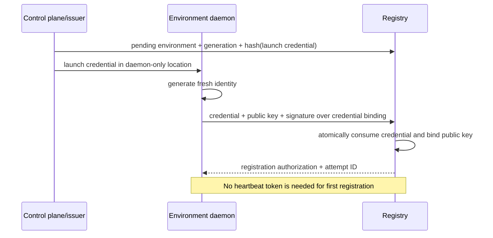
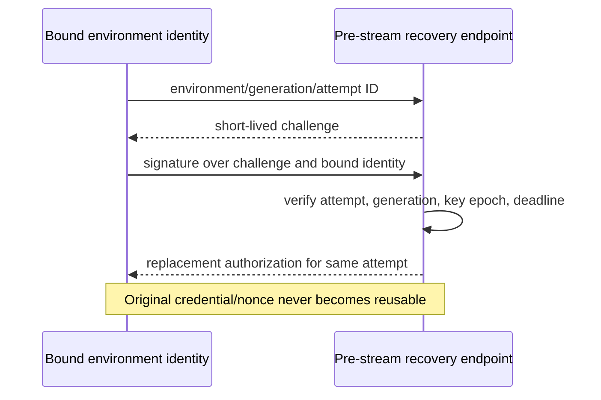

# Persistent executor feasibility contract

This document freezes Task 0 decisions for revision 78. It is a preliminary
feasibility contract, not release qualification and not deployment approval.
Numerical KPIs in the implementation plan remain unchanged.

## R1 — cancellation while disconnected

The environment installs the original absolute turn deadline during turn
authorization. It converts that server deadline once to a conservative
monotonic deadline and runs a watchdog thread independent of tool-serving
threads. Deadline expiry atomically stops admission, cancels all operation
process groups, drains output, proves process exit, revokes the shared broker
capability once, and requests sandbox termination if any proof is missing.

Explicit Stop durably revokes the turn first. While connected, reserved control
capacity carries a priority cancel. Without an acknowledgement, the VPS
immediately asks Modal to terminate the exact sandbox and polls independent
lifecycle evidence for confirmed termination. A submitted request or database
flag is not containment. Unknown process, egress, usage, or termination state
retains the environment and spend reservations.

A renewable execution lease does not resolve the accepted semantics. A lease
short enough for sub-second Stop containment would expire during the allowed
30-second connection recovery window; a lease long enough for that recovery
cannot observe an early Stop inside the 250/500 ms delivery KPI. V1 therefore
keeps the absolute local deadline and Modal termination fallback. Lease expiry
may be additional containment evidence, but never Stop receipt.

Revision 79 distinguishes delivery from containment. Connected explicit Stop
and every local deadline still require executor observation within p95/p99
250/500 ms and containment within p95/p99 1/2 seconds. A Stop committed while
the executor is disconnected has no delivery percentile: it immediately
revokes authorization, bypasses the 30-second recovery window, requests Modal
termination, and must independently prove process exit, egress shutdown, and
sandbox termination within p95/p99 1/2 seconds. Missing proof is a failure and
retains every uncertain environment and spend reservation.

## R2 — actual process parallelism

One exclusive turn binding owns broker capability installation and revocation.
The binding admits at most four operations. Each owns its process group,
cancellation event, output budget, operation identity, and terminal result.
Execution happens outside lifecycle locks. A fifth operation waits on the turn
condition and is released immediately by teardown; it cannot block Stop.

Ordinary operation completion releases only its operation slot. Turn teardown
first stops new starts, then waits for or terminates every process group, and
finally clears the broker capability exactly once. `/workspace` remains shared;
callers must preserve declared dependency order and overlap only independent
work.

## R3 — bootstrap and reconnect authentication

Frozen limits:

- launch credential TTL: 60 seconds, single use;
- recovery challenge TTL: 10 seconds;
- attempt retention/recovery window: 60 seconds;
- at most three recovery challenges per attempt;
- heartbeat/reconnect token TTL: 45 seconds;
- active stream recovery remains bounded to 30 seconds;
- valid authentication starts: 250/second/shard;
- invalid traffic: 10/second/source burst 20 and 100/second/shard burst 200;
- pre-authentication frame: 2 KiB within two seconds.





```mermaid
sequenceDiagram
    participant E as Environment
    participant S as Priority scheduler
    participant N as Durable nonce store
    E->>S: signed heartbeat token
    alt scheduler saturated
        S-->>E: bounded randomized retry
        Note over E,S: nonce is preserved
    else slot allocated
        S->>N: atomically consume nonce
        N-->>S: exactly one winner
        S-->>E: begin identity-authenticated handshake
    end
    alt handshake/response lost after consumption
        E->>S: bounded challenge recovery using bound identity + attempt ID
        Note over E,S: consumed token is not reused; no second registration
    end
```

An issuer-authorized generation transition copies only the already-bound public
identity into the new provisioning record and fences the old generation. Old
tokens cannot authorize the new route. Active old-generation streams stay on
their draining route; only unclaimed environments transition.

## R4 — process-loss recovery

Browser/SSE loss continues the durable turn and replays the journal by event
ID. Environment socket or rendezvous loss resumes the same encrypted stream
only while both Noise peers, bounded sequence/replay state, and the claim
survive. Pi worker loss attaches a replacement only when provider recovery can
prove delivered work is not repeated; otherwise the turn fails explicitly,
while surviving admission capacity is reported separately.

Harness loss cannot reconstruct its private Noise state. It yields typed
transport loss, fences the turn, contains remote work, and never retries a
command. Environment daemon loss invalidates the environment, terminates its
sandbox, reconciles unknown outcomes, and reduces ready capacity until a fresh
environment with a new identity registers. Fault evidence is collected at
before-delivery, after-acceptance, during-execution, and
terminal-before-client-delivery boundaries.

## R5 — qualification and spend

`backend.loadtests.persistent_executor_feasibility` is the versioned manifest
schema. Preflight is fail closed and runs before provisioning or model traffic.
It requires exact source/image/protocol/schema identities, staging environment
and region, idle and loaded baseline evidence, workload and fault schedules,
nearest-rank percentile rules, and every numeric resource/spend ceiling.

The revision 81 feasibility budget ceiling is $16.25. Provider calls and tokens
are zero for Task 0. The increase from the preliminary $10 ceiling preserves
both frozen 1,000-sample destructive partition-Stop profiles at the official
0.5-core/0.5-GiB sandbox rate rounded up to 24 micro-USD/second and reserves the
full 240-second lifetime for every creation, including discarded preliminary
attempts plus the distinct 32-sandbox real-network reconnect cohort. Per-profile
offered rates separate the 32-way cold burst from cold
samples paced at four starts/second under the measured five-start/second Modal
workspace ceiling. The sandbox creation/runtime
envelope, operating reserves, and unknown-usage reserve are explicit in the
frozen run manifest. Unknown usage retains its reservation, and exhaustion
stops new work without abandoning covered turns. Preliminary and release
reports have disjoint status values.

Resource gates retain host CPU below 80% and `MemAvailable` at least 1,536 MiB.
The run manifest additionally freezes disk, process RSS/FDs, PostgreSQL total
and incremental connections, checkpoint write rate, event-loop lag, transport
buffers, reserved control capacity, sampling interval, and breach action.

## R6 — latency profiles

Cold first `pwd` uses the intended immutable staging image in `eu-west`, with
blank and retained reuse disabled, and attributes provisioning, bootstrap,
Noise attach, readiness, and command time while retaining end-to-end latency.
The same profile runs with 32 simultaneous cold turns as a correctness and
capacity gate: all 32 must finish without error and the reported p99 (the
maximum with this cohort size) remains bounded by the unchanged five-second
cold p99 target. The separately frozen 1,000-sample cold profile owns the
unchanged two-second p95 and five-second p99 tail gates. Warm ACK and no-op are
separate profiles.

The reconnect gate first runs 1,000 protocol-faithful peers through the real
issuer, scheduler, nonce-consumption, authentication, and readiness path, then
runs a separately counted real-Modal network cohort. Reports label simulation
and real Modal counts. Authentication starts never exceed 250 in a sliding
second and reconnect readiness remains p99 at most five seconds. A cold process
replacement is not reported as resumable connection loss.

Task 0 stays incomplete until these profiles and partition cancellation have
measured evidence with the frozen sample counts. A local deterministic pass is
implementation evidence only and cannot substitute for the real-Modal gates.

## Task 0 diagnostic — 2026-09-12

The staging probe used source commit
`caf4cbb9c030c2c7b2df88674c93c01eafd05c0a`, candidate Modal image
`im-B65tTXXeeVuGY1Kp7HQbcO`, and static environment binary SHA-256
`b675b85a44b732309b947c71fd85fd5aed589bf141e415ff90224986a859b96c`.
Its first cold `pwd`, including sandbox creation through terminal result, took
1,600.994 ms. The in-sandbox Hybrid IK attach took 1.835 ms and the encrypted
command took 1.655 ms. These are diagnostic single observations, not completed
latency profiles.

After the transport was treated as disconnected, an explicit Stop triggered
the independent Modal control-plane fallback. Modal confirmed sandbox
termination, process exit, and egress revocation in 735.542 ms, but the
executor could not observe a Stop frame across the partition. Delivery is
therefore a censored failure, not zero latency, and the accepted 500 ms p99
delivery gate fails even though the two-second containment gate passes.

This observation blocked the revision 78 contract. Revision 79, explicitly
approved on 2026-09-12, resolves the contradiction by making independent
containment—not impossible remote receipt—the partition-case gate. It preserves
all connected delivery and universal containment numbers. Task 0 qualification
is reopened under manifest schema v2; Tasks 1–11 remain gated until all R1–R6
evidence passes.
